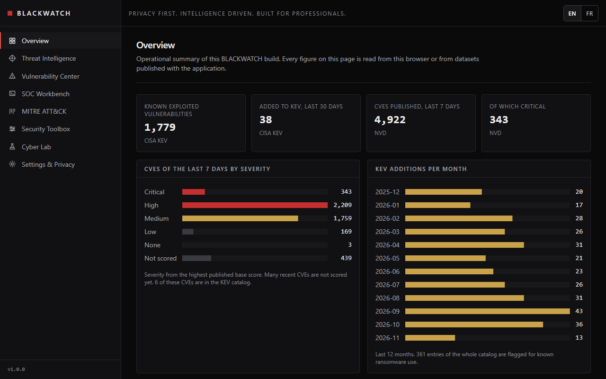
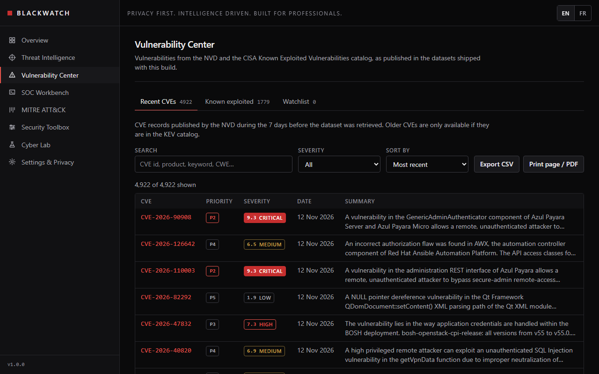
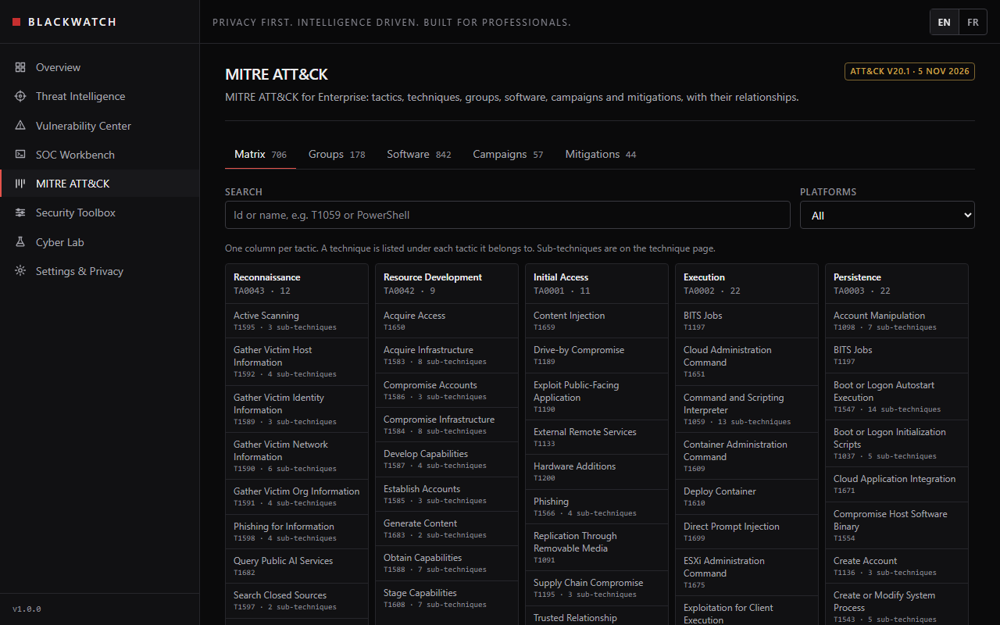
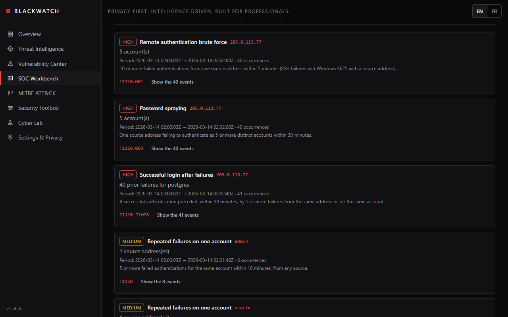
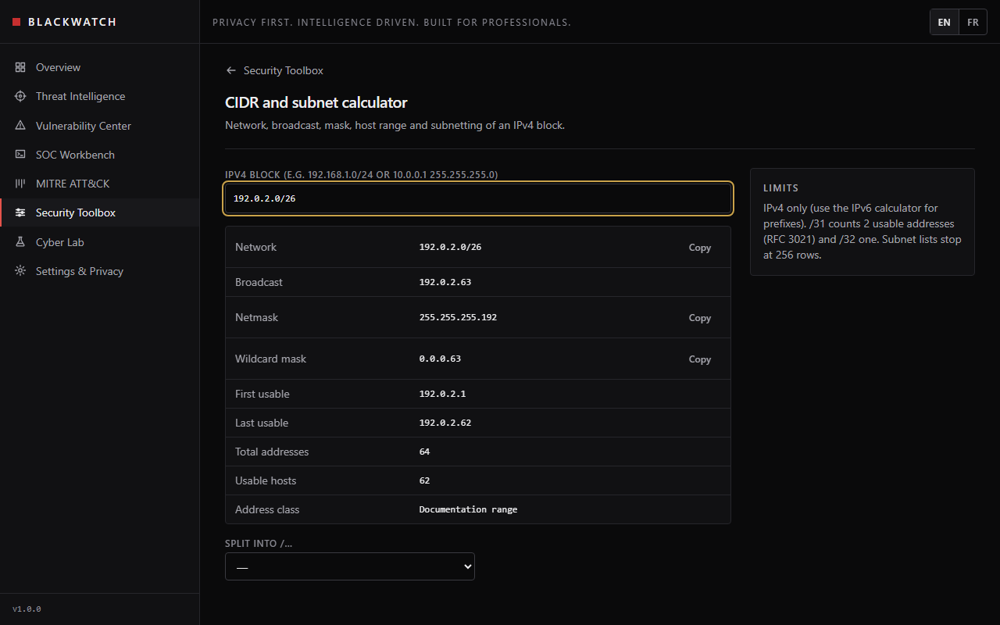
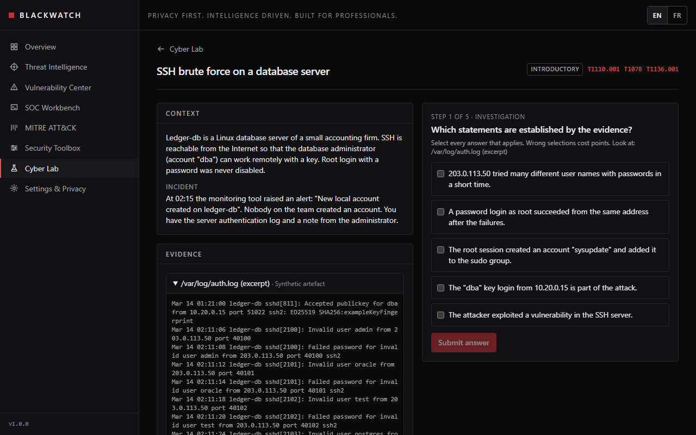

# BLACKWATCH

**Privacy first. Intelligence driven. Built for professionals.**

BLACKWATCH is a cybersecurity workbench that runs entirely in the browser: threat intelligence,
vulnerability management, SOC investigation tooling, MITRE ATT&CK exploration, security utilities
and incident response training. It is a static application — no account, no backend, no tracking.
Files and text you provide are processed locally and never leave your device.

> **Status: 1.0.0.** All modules work on real, traceable public data or on your own files, and the
> application is installable and usable offline. Partial areas are stated below and on their pages;
> no placeholder data is shown. See [PROJECT_STATE.md](PROJECT_STATE.md) for the exact status and
> [QUALITY_REPORT.md](QUALITY_REPORT.md) for what was tested, and on which browsers.

## Features

| Area | Status |
| --- | --- |
| Application shell, responsive navigation, keyboard and screen-reader support | Implemented, tested |
| French / English interface, switchable at runtime | Implemented, tested |
| Settings: language, theme, density, reduced motion, favorites, local data export and deletion | Implemented, tested |
| Static data pipeline: retrieval, validation, normalisation, provenance, last-valid-copy fallback | Implemented, tested |
| Overview dashboard: KEV and CVE figures, severity distribution, latest advisories, dataset freshness | Implemented, tested |
| Vulnerability Center: CVE search, CVSS 3.x and 4.0, CWE, CISA KEV status, explained prioritisation, watchlist, CSV export, print | Partial: CVEs of the last 7 days plus all KEV entries only; no OSV or GitHub Advisory data |
| MITRE ATT&CK Explorer: Enterprise matrix, techniques, sub-techniques, groups, software, campaigns, mitigations, detection strategies, relationships | Implemented, tested |
| Threat Intelligence: CERT-FR and KEV feed, IOC explorer (extraction, validation, classification, export), threat actors, campaign timeline, notes | Partial: no indicator reputation feeds, no indicator relationship graph |
| SOC Workbench: local import of JSON/JSON Lines, CSV, syslog and auth logs, Apache/Nginx access and error logs, Windows Event XML; format detection with override; parse statistics; explicit time assumptions; 12 detection rules; Sigma subset; events, timeline, entities; saved investigations; Markdown, CSV and JSON exports | Implemented, tested. Binary EVTX is not supported (export to XML first) |
| Security Toolbox: 20 local tools (hashing incl. MD5 and files, Base64, hex, entropy, JWT, JSON, URL, IOC, regex with timeout, IPv4/IPv6/CIDR, IANA ports, HTTP headers, password patterns, TLS reference, Sigma and YARA viewers, file inspector) | Implemented, tested |
| Cyber Lab: ten synthetic incident response scenarios (SSH brute force, phishing, ransomware, lateral movement, PowerShell, web compromise, account takeover, exfiltration, Active Directory misconfiguration, network intrusion) with evidence, graded decisions, cited guidance, local progress and Markdown reports | Implemented, tested |
| Installable web application: offline application shell, offline copies of opened datasets served only while they match the published checksums, update notice that never reloads on its own | Implemented, tested on Chromium |
| Accessibility: keyboard navigation, focus management, WCAG 2.2 A/AA rules checked with axe in both themes | Implemented, tested (automated checks) |

### Screenshots

Captured from the production build with the live datasets (`scripts/docs-screenshots.mjs`). The
SOC Workbench view uses a synthetic log.

| | |
| --- | --- |
|  |  |
|  |  |
|  |  |

## Architecture

- **Static frontend.** A single-page application served as static files. Routing uses the URL
  hash and all asset URLs are relative, so the same build works under any GitHub Pages sub-path.
- **Local processing.** Indicator extraction, CVSS decoding, search and investigation state run in
  the browser. Persistent data (preferences, watchlist, notes) is stored in IndexedDB.
- **Static data pipeline.** `scripts/data/build.mjs` retrieves the public datasets, validates them
  against the schemas in `src/data/schemas.ts`, normalises and deduplicates them, records
  provenance, licence, retrieval time and checksum in `data/manifest.json`, and writes static JSON
  files next to the application. If a source fails, the last valid copy is kept and flagged
  "stale"; a source with no valid copy is flagged "missing". The browser only ever reads these
  files: it never contacts the publishers. The pipeline also publishes a 5 kB summary for the
  Overview, used only while it matches the checksums of the datasets it was computed from.
- **Offline support.** A service worker generated at build time (`scripts/pwa/sw.template.js`)
  precaches the application files, keeps a copy of each dataset you open, and serves that copy
  offline only if its SHA-256 matches the cached manifest. A new version is announced and applied
  when you choose to reload; other open tabs are then asked to reload when convenient.

```
src/
  app/         shell, routing, module registry, preferences provider
  components/  shared interface components
  data/        dataset schemas, loader, React hooks
  i18n/        English and French dictionaries
  lib/         CVSS, IOC, ATT&CK, prioritisation, export, storage
  toolbox/     tool registry, pure tool libraries, workers, tool views
  soc/         log parsers, detections, Sigma subset, worker, workbench views
  lab/         scenario engine, catalogue and the ten synthetic scenarios
  pwa/         service worker registration and update notice
  pages/       one lazily loaded view per route
scripts/data/  data pipeline (retrieval, normalisation, Overview summary)
scripts/pwa/   service worker template
e2e/           Playwright end-to-end tests (production build, fixture data)
public/licenses/ third-party licence texts shipped with the site
public/reference/ IANA port registry extract (generated, committed)
docs/screenshots/ README screenshots
```

Design decisions are recorded in [DECISIONS.md](DECISIONS.md).

## Technology stack

React 19 · TypeScript (strict) · Vite · Tailwind CSS 4 · React Router · Dexie (IndexedDB) · Zod ·
Vitest + Testing Library · Playwright · ESLint · GitHub Actions · GitHub Pages.

No web fonts, analytics or third-party scripts are loaded. Charts are plain SVG with the values
also printed as text; ECharts was not needed for the current views.

## Getting started

Requirements: Node.js 24 or later (the data pipeline imports a TypeScript schema file directly)
and npm.

```bash
npm ci
npm run data:build
npm run dev
```

`npm run data:build` downloads about 11 MB of public data into `public/data/` (ignored by Git).
Without it the application runs and states that no dataset is published.

### Scripts

| Command | Purpose |
| --- | --- |
| `npm run dev` | Development server with hot reload |
| `npm run data:build` | Retrieve and validate the datasets into `public/data/` |
| `npm run reference:ports` | Regenerate the IANA port reference |
| `npm run icons` | Regenerate the PNG application icons from `public/favicon.svg` |
| `npm run build` | Production build in `dist/` |
| `npm run preview` | Serve the production build locally |
| `npm run lint` | ESLint |
| `npm run typecheck` | TypeScript, strict mode |
| `npm test` | Unit, integration and pipeline tests (Vitest) |
| `npm run test:e2e` | End-to-end tests on desktop and mobile Chromium (run `npx playwright install chromium` once); set `E2E_ALL_BROWSERS=1` to add Firefox and WebKit, as CI does |
| `npm run check:identity` | Repository identity policy check |
| `npm run audit:deps` | Dependency vulnerability audit |
| `npm run verify` | Lint, typecheck, tests, build and identity check |

## Deployment

`.github/workflows/deploy.yml` runs on every push to `main` and once a day. It refreshes the
datasets, runs `npm run verify` and publishes `dist/` to GitHub Pages. To enable it, set
**Settings → Pages → Source** to **GitHub Actions**. No secret is required; an optional
`NVD_API_KEY` repository secret raises the NVD rate limit. `ci.yml` runs the tests on pushes and
pull requests and never contacts the data sources. Workflow actions are pinned to commit SHAs.
If a new ATT&CK release retires an identifier cited by the Cyber Lab, the daily deployment reports it
in a failed, non-blocking step and still publishes the refreshed datasets.

## Supported browsers

Current versions of Chrome, Edge, Firefox and Safari. The minimum versions follow from the
platform features the code relies on: Chrome and Edge 111, Firefox 128, Safari 16.4 (CSS of
Tailwind 4, regular expression look-behind in the indicator extractor). Offline support needs
service workers, which private browsing modes may disable.

Tested: Chromium (desktop and mobile emulation), automatically. Firefox and WebKit run in CI; see
[QUALITY_REPORT.md](QUALITY_REPORT.md) for whether that run has passed.

## Privacy model

- No registration, accounts, analytics, advertising, telemetry or fingerprinting.
- The browser only requests files hosted with the application. Links to external references
  (NVD, vendor advisories, attack.mitre.org) open only when you click them, in a new tab, without
  a referrer.
- Text pasted into the IOC explorer and the toolbox, passwords, tokens and imported files are
  processed in the browser and never uploaded, stored or put in the URL.
- Preferences, the watchlist, notes, saved investigations and Lab progress are stored in
  IndexedDB in your browser profile; copies of the public datasets you opened are kept in the
  browser's Cache Storage for offline use. **Settings & Privacy** lets you export your data as JSON
  or erase it, dataset copies included.
- GitHub Pages, as the host, can observe standard connection metadata (such as IP address and
  user agent) when the application and its datasets are downloaded.

## Security limitations

- **Content Security Policy is delivered through a `<meta>` element**, because GitHub Pages does
  not allow custom HTTP response headers. `frame-ancestors`, `report-uri` and `sandbox` are
  therefore unavailable (the application cannot forbid being framed), and headers such as
  `Strict-Transport-Security`, `X-Content-Type-Options`, `Referrer-Policy` or
  `Permissions-Policy` cannot be set by this project on that host.
- The policy forbids inline scripts and inline style elements, restricts connections to the
  application's own origin and disables form submission.
- Dataset content is third-party text. It is validated against strict schemas and always rendered
  as text, never as HTML.
- IndexedDB content is not encrypted and is readable by anyone with access to the browser profile.
- **Shared origin.** GitHub Pages serves every project site of an account from the same origin
  (`<account>.github.io`). Pages published from the same account can therefore read this
  application's IndexedDB and Cache Storage. The service worker only touches caches whose name
  starts with `blackwatch-`.
- BLACKWATCH is an analysis and training aid. Verify critical results independently.

## Data sources

Each source was checked for licence, redistribution terms, attribution and rate limits before
integration. Every page that shows data lists its sources, licence, retrieval time and freshness.

| Source | Content | Licence / terms | Notes |
| --- | --- | --- | --- |
| [CISA KEV](https://www.cisa.gov/known-exploited-vulnerabilities-catalog) | Known exploited vulnerabilities | [CC0 1.0](https://www.cisa.gov/sites/default/files/licenses/kev/license.txt) | No endorsement by CISA or DHS is implied. |
| [NVD CVE API 2.0](https://nvd.nist.gov/developers/vulnerabilities) | CVE records of the last 7 days, and records of KEV entries | [NVD API Terms of Use](https://nvd.nist.gov/developers/terms-of-use) | This product uses the NVD API but is not endorsed or certified by the NVD. A subset of fields is shown, unaltered. Public rate limit respected (5 requests / 30 s). Rejected CVE ids are excluded. |
| [MITRE ATT&CK STIX data](https://github.com/mitre-attack/attack-stix-data) | Enterprise ATT&CK, latest version | [ATT&CK Terms of Use](https://attack.mitre.org/resources/legal-and-branding/terms-of-use/) | © 2026 The MITRE Corporation. This work is reproduced and distributed with the permission of The MITRE Corporation. Full licence in [`public/licenses/mitre-attack.txt`](public/licenses/mitre-attack.txt). Long descriptions are shortened. |
| [IANA port registry](https://www.iana.org/assignments/service-names-port-numbers/) | TCP/UDP service names and ports (toolbox) | [CC0 1.0](https://www.iana.org/help/licensing-terms) | Snapshot committed with its retrieval date. |
| [IANA TLD list](https://data.iana.org/TLD/tlds-alpha-by-domain.txt) | Top-level domains (IOC validation) | [CC0 1.0](https://www.iana.org/help/licensing-terms) | Snapshot embedded with its version line. |
| [CERT-FR](https://www.cert.cyber.gouv.fr/) | Advisory and alert titles and summaries (RSS) | [Licence Ouverte 2.0 (Etalab)](https://www.etalab.gouv.fr/licence-ouverte-open-licence/) | Source: CERT-FR (ANSSI). |

**Evaluated and not integrated:** abuse.ch feeds (URLhaus, ThreatFox, MalwareBazaar) — their terms
restrict use to non-commercial purposes, require authentication and forbid derivative works
without consent, so redistribution in a public static site is not clearly allowed. OSV and the
GitHub Advisory Database are planned.

Dataset text is published verbatim by these organisations and may name any vendor or product.

## Licensing

BLACKWATCH source code is released under the [MIT License](LICENSE). The licence covers this
project's code only: the datasets above and third-party assets remain under their own terms.

## Contributing

Issues and pull requests are welcome. Before opening a pull request:

1. Run `npm run verify` and `npm run test:e2e`.
2. Add or update tests for any behaviour you change.
3. Add both English and French strings for any interface text.
4. Do not add features that send user data to a server, load third-party resources at runtime or
   display fabricated data.

## Known limitations

- Cyber Lab answer keys express common incident response practice and cite their sources; local
  policies and laws (notification deadlines in particular) take precedence.
- SOC Workbench: binary EVTX is not read (export to XML); Sigma support is a documented subset;
  detections are heuristics with fixed parameters; limits are 100 MB per file, 500,000 events per
  analysis and 100,000 events per saved investigation (measured, see DECISIONS.md D-031).
- Toolbox: CVSS-style or password "scores" are not produced on purpose; Sigma and YARA rules are
  displayed, never executed; regular expressions use JavaScript syntax only.
- The Vulnerability Center only covers CVEs published in the 7 days before the last dataset
  refresh, plus every KEV entry. Other CVEs link to the NVD.
- CVSS 4.0 vectors are decoded but scores are not recomputed locally; CVSS 3.x base scores are
  recomputed and compared with the published score.
- Affected version ranges are not shown; the NVD record is the reference.
- Offline, only the datasets opened while online are available, and only while they match the
  last manifest seen.
- Light-theme users may see the dark background for an instant at start-up.
- Firefox and WebKit could not be run on the development machine; their results depend on CI.
  The offline support is tested on Chromium only.

## Development assistance disclosure

Development of this project was assisted by Claude. Although efforts have been made to review,
test and validate the implementation, errors, omissions or security vulnerabilities may still
exist. Users should independently verify critical results before relying on them.
